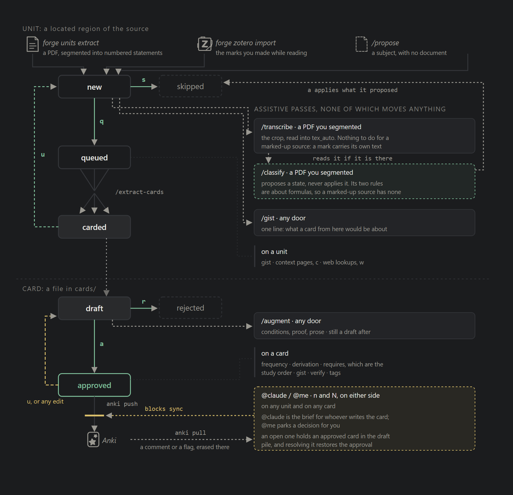
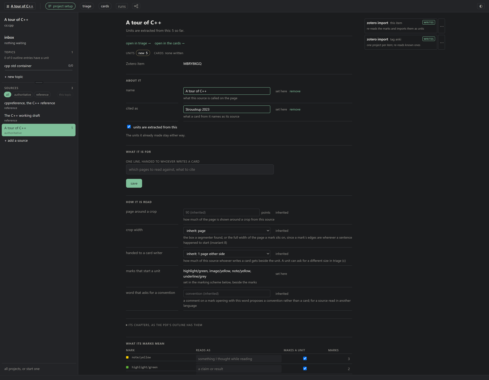
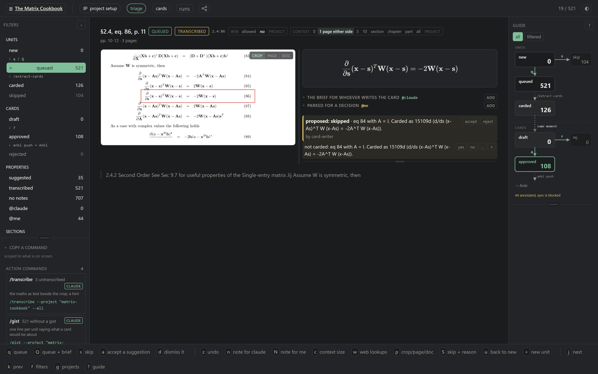
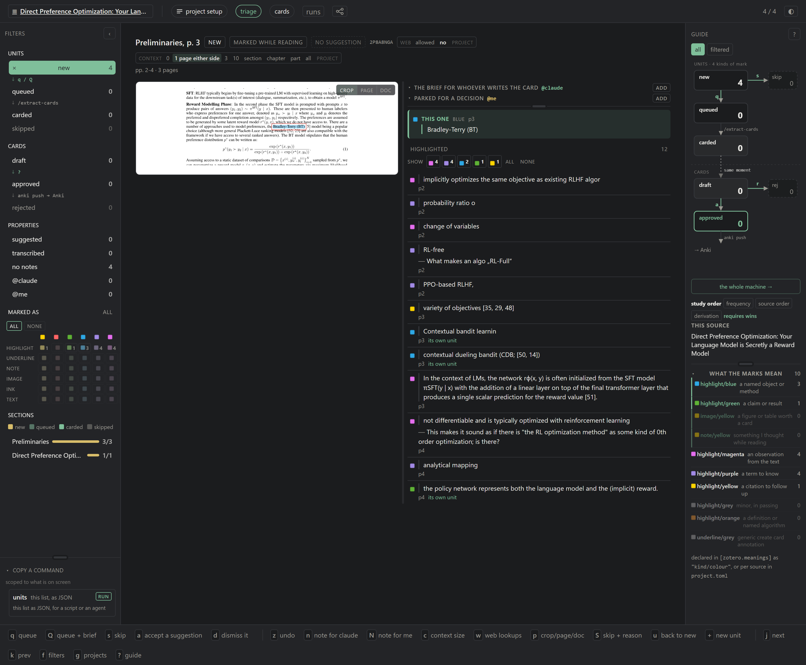
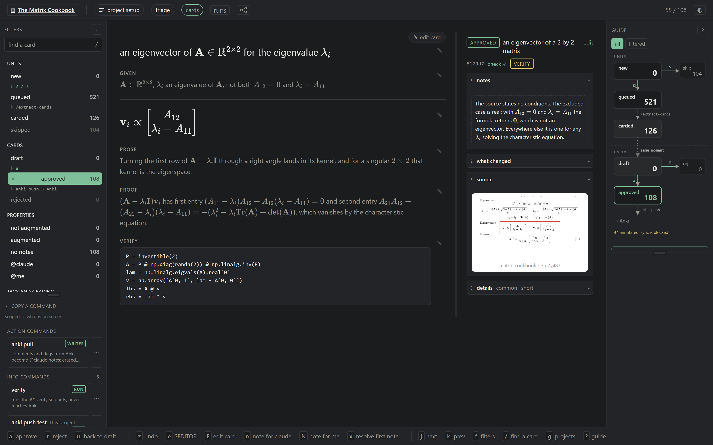
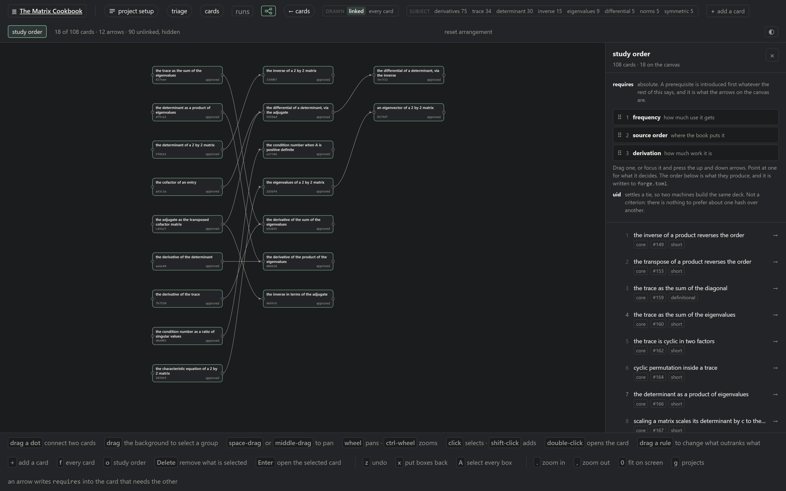

# anki-math-forge

[](https://github.com/robin-koppelhuber/anki-math-forge/actions/workflows/checks.yml)
[](LICENSE)
[](pyproject.toml)
[](https://apps.ankiweb.net/)
[](https://www.zotero.org/)

Turn math-heavy texts into Anki cards with a human in the loop.

1. Import standalone PDFs, entries from your Zotero collection or just start from an idea.
2. Decide which parts of a source are worth putting into a card.
3. Generate cards and iterate until they are perfect.

## Features
- Local website to build cards and iterate together with AI.
- Create anki decks from standalone PDFs, entries from your Zotero collection or start from an idea.
- Import Zotero annotations and images as starting points for your cards.
- Augment equations with proof outlines, intuition and use cases.
- Optimized study order: let AI classify the usefulness, hardness and dependency between cards and explore them in a graph view, for the optimal initial study order in Anki.
- Sync cards to Anki and update safely if something changes.
- Write card feedback directly in Anki, sync it back into the website and improve your cards.

---
- Supported models: currently only works with a Claude Code subscription, no
  API key needed. The website gives you Claude skill commands to run instead
  of triggering API calls from code.

## Quickstart

```
git clone https://github.com/robin-koppelhuber/anki-math-forge
cd anki-math-forge
uv sync --extra pdf      # PyMuPDF (AGPL), reads and renders the PDFs
npm install              # optional: gives `check` the real KaTeX parser
```

1. Run Zotero (version 7+) with its local API enabled (*Settings > Advanced*).
2. Mark up the paper or book in Zotero's reader and tag the item `anki`.
3. Start the website and import the tagged items from its first page.

```
uv run forge serve       # http://127.0.0.1:8000, press ? for the guide
```

- Each item becomes a project.
- Its cards go to `Zotero::<title>` unless the generated `project.toml` names a deck.

Anki, once:

1. Install AnkiConnect: *Tools > Add-ons > Get Add-ons*, code `2055492159`,
   restart Anki.
2. Leave Anki running while you sync. `anki push` talks to
   `http://127.0.0.1:8765`; `ANKI_CONNECT_URL` or `[anki] url` changes it.
3. The deck and the note type are created on the first sync.

## Workflow

1. **Units.** Each mark you made becomes a unit, a candidate for a card. You triage them: queue the ones worth a card, skip the rest.
2. **Cards.** Claude drafts a card from each queued unit. You review it, edit it and approve it.

```
import  ->  units  ->  triage  ->  cards  ->  review  ->  sync
                       (you)       (Claude)   (you)
```



Triage, review and the push to Anki happen on the website. The passes that need a model are Claude Code slash commands, and the website shows the line to paste beside what is waiting:

- `/gist`: one line per unit on what its card would be about
- `/extract-cards`: a draft card from each queued unit
- `/augment`: conditions, proof and prose on the drafts
- `/triage claude`: works your `@claude` annotations
- `/sort-notes`: places what you put in the inbox

Flags and the `forge` commands: [docs/COMMANDS.md](docs/COMMANDS.md).

## The website



Project setup



Triage



A marked-up paper



Review



The dependency canvas

## Starting from an idea

- Start a project on the website and say what you want cards for.
- `/sources` proposes reference material to check cards against.
- `/propose` turns what you asked for into units.

## Legacy: PDFs without Zotero

- Declare the PDF in `projects/<name>/project.toml`.
- Run `forge units extract <name>`, or the same command from the website.
- Then `/transcribe` and `/classify`.
- It only finds numbered statements. It was fitted to one textbook.
- Reading the marks inside a PDF is on the [roadmap](docs/ROADMAP.md).

```toml
title = "The Matrix Cookbook"
citation = "Matrix Cookbook"
deck = "Mathematics::Matrix Calculus"   # optional; falls back to [anki] deck

[[sources]]
files = ["projects/<name>/the-file.pdf"]
```

## Documentation

- [docs/COMMANDS.md](docs/COMMANDS.md): every command, and the Anki and deck settings.
- [CLAUDE.md](CLAUDE.md): the invariants and the card format.
- [docs/DESIGN.md](docs/DESIGN.md): the design.
- [docs/CONTRACT.md](docs/CONTRACT.md): the reasoning behind each invariant.
- [docs/VERBS.md](docs/VERBS.md): how commands are named, and why one word never writes.
- [docs/STYLE.md](docs/STYLE.md): how prose is written here, and what each object is called.
- [docs/ROADMAP.md](docs/ROADMAP.md): what is left to build.

## Contributing and license

Contributions are welcome. Open a pull request.

License: MIT. `--extra pdf` pulls PyMuPDF, which is AGPL.
